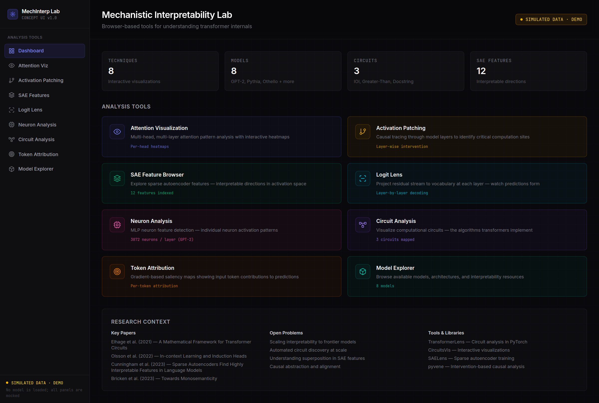
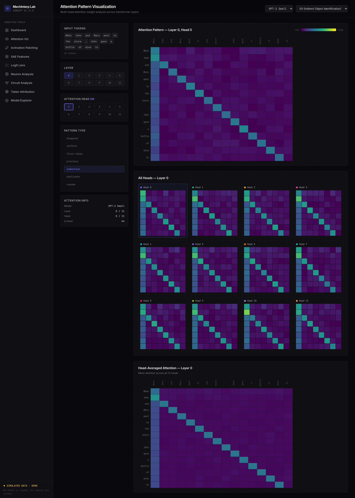
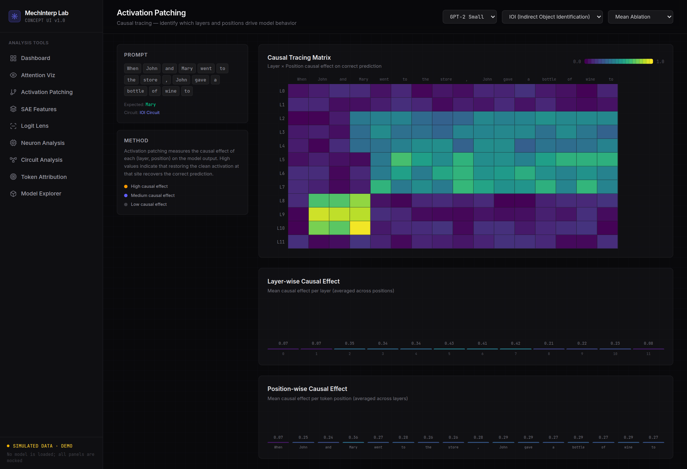
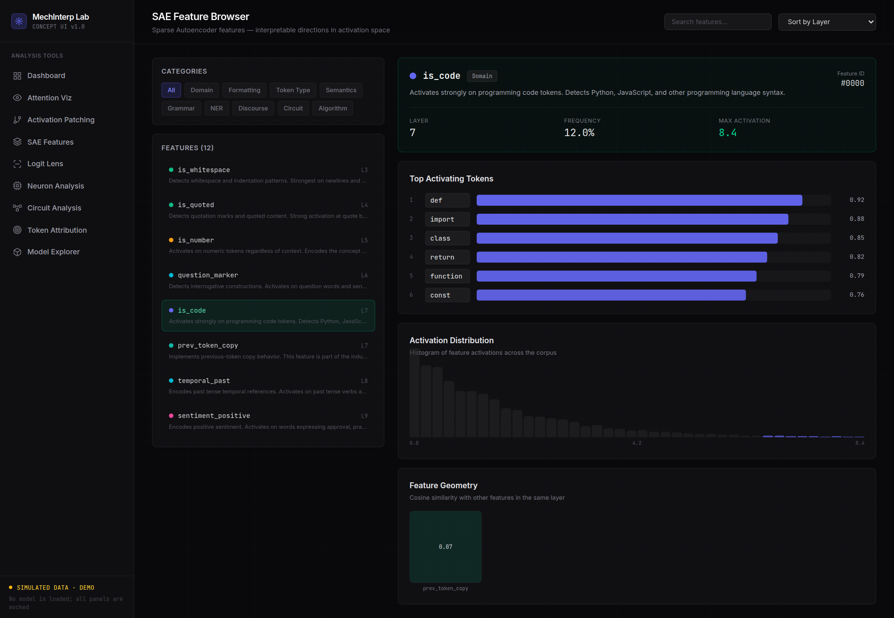
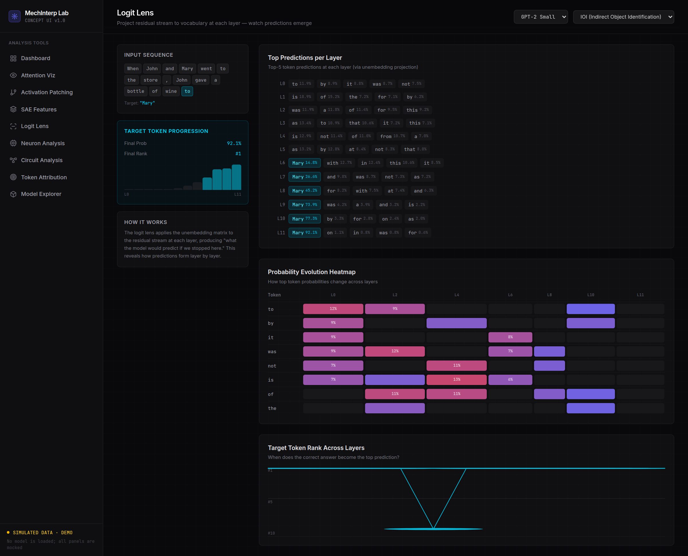
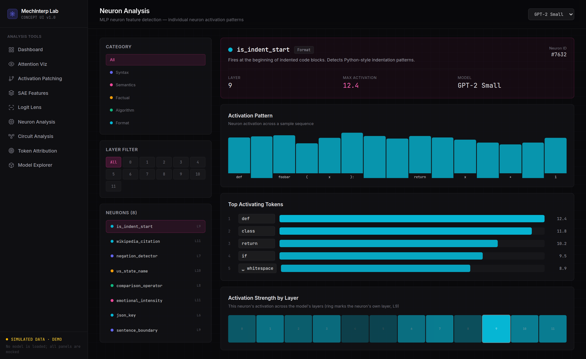
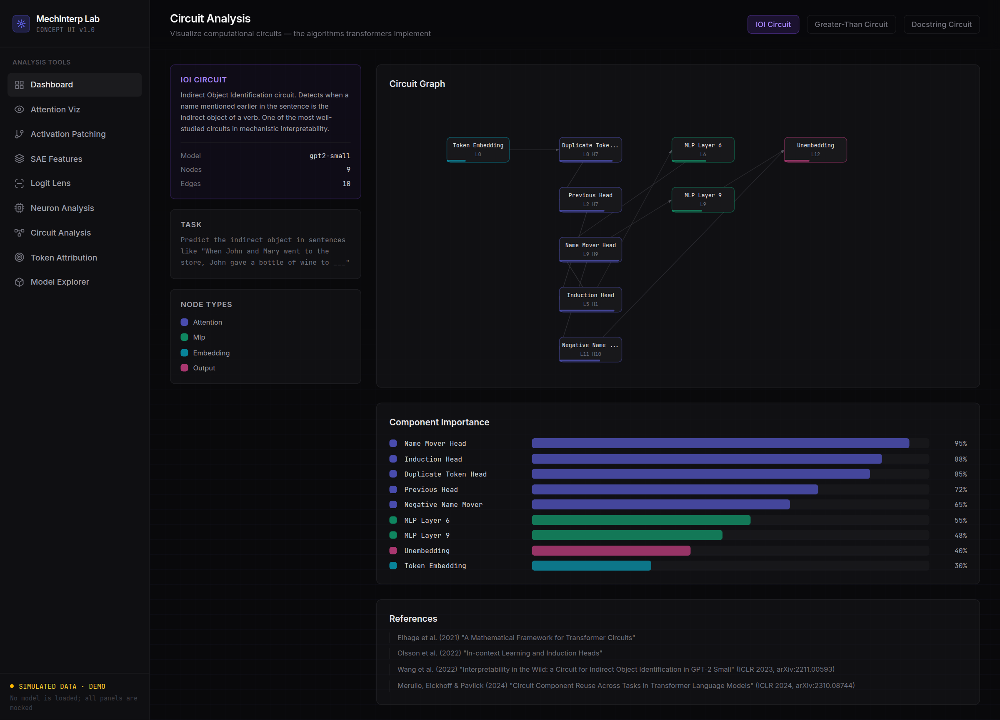
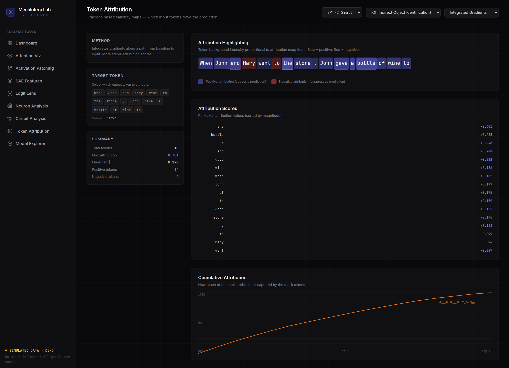
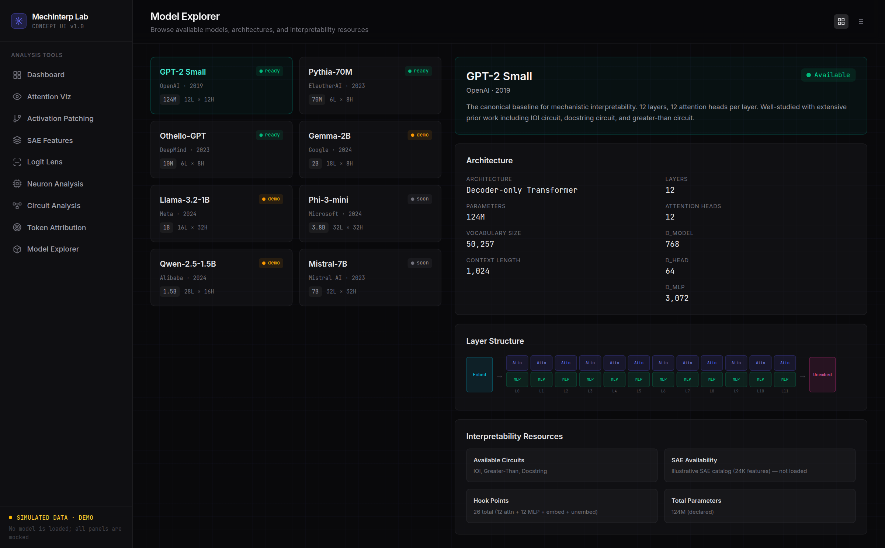

# MechInterp Lab

A browser-based console for mechanistic interpretability, shipped as a front-end concept piece. Nine views cover the standard toolkit — attention patterns, activation patching, sparse-autoencoder features, the logit lens, MLP neurons, circuit graphs, token attribution and a model explorer — with the interactions and chart types you would expect from a real research tool.

There is no model behind it. Nothing is loaded, nothing is inferred, and no request ever leaves the page.

> **All data is simulated.** Every weight, activation, attention score, feature and attribution value on every page is generated in the browser by a seeded PRNG in `src/lib/data.ts`. The console is a UI study, not a working interpretability tool. Do not read any number here as a measurement.

## Screenshots

| | |
|---|---|
|  |  |
|  |  |
|  |  |
|  |  |
|  | |

## The nine views

| Route | What it draws | Data source |
|---|---|---|
| `/` | Landing page with the tool grid and a research-context panel | static lists |
| `/attention` | Per-head attention heatmaps, a head-comparison grid and a head-averaged matrix | `generateAttentionPattern()` |
| `/patching` | Causal-tracing matrix over layers × positions, with layer and position marginals | synthetic, keyed to the selected prompt |
| `/sae` | Feature browser with category filters, search, top activating tokens and feature geometry | `saeFeatures` |
| `/logit-lens` | Top-5 predictions per layer, a probability heatmap and rank evolution of the target token | `generateLogitLensData()` |
| `/neurons` | Single-neuron profile, activation pattern over a sample sequence, cross-layer map | `neuronFeatures` |
| `/circuits` | Circuit graph with typed nodes and weighted edges, plus a component-importance ranking | `circuits` |
| `/attribution` | Per-token attribution scores, cumulative attribution curve and token ranking | synthetic, keyed to method and prompt |
| `/models` | Model cards and a comparison table with architecture details | `models` |

The same seeded generator powers the attention, patching, logit-lens, neuron and attribution pages, so a given (model, prompt, layer, head) combination always draws the same picture. Reloading the page does not change the numbers, which is what makes the UI feel like a tool rather than a mockup. It also means the values are reproducible, and reproducible is not the same as meaningful.

The three circuits in the graph view are modelled on published work (IOI in GPT-2 small, greater-than, and Python docstrings in a 4-layer attention-only transformer). The node types, head indices and edge directions follow the papers; the importance weights are invented.

## Tech stack

- Next.js 16 (App Router, Turbopack) with `output: 'export'`
- React 19
- Tailwind CSS 4, with the design tokens documented in `DESIGN.md`
- Hand-written SVG for every chart — no charting library
- Inter and JetBrains Mono loaded from Google Fonts via `<link>`

## Running it

```bash
npm install
npm run dev        # http://localhost:3000
```

Type-check and lint:

```bash
npm run ts-check
npm run lint
```

## Static export

```bash
npm run build      # writes out/
```

Because the build is a static export, `BASE_PATH` has to be set when the site is served from a sub-path:

```bash
BASE_PATH=/mechinterp-lab npm run build
```

Any static host will do. The GitHub Actions workflow in `.github/workflows/deploy-pages.yml` builds with `BASE_PATH=/mechinterp-lab`, adds `out/.nojekyll` and publishes `out/` to GitHub Pages.

## Points of reference

The label schemes, circuit names and the shape of the numbers follow this literature.

- Elhage et al. (2021), *A Mathematical Framework for Transformer Circuits*, Transformer Circuits Thread.
- Olsson et al. (2022), *In-context Learning and Induction Heads*, arXiv:2209.11895.
- Wang et al. (2023), *Interpretability in the Wild: a Circuit for Indirect Object Identification in GPT-2 small*, ICLR 2023, arXiv:2211.00593.
- Hanna, Liu & Variengien (2023), *How does GPT-2 compute greater-than? Interpreting mathematical abilities in a pre-trained language model*, NeurIPS 2023, arXiv:2305.00586.
- Heimersheim & Janiak (2023), *A circuit for Python docstrings in a 4-layer attention-only transformer*, Alignment Forum.
- Cunningham et al. (2023), *Sparse Autoencoders Find Highly Interpretable Features in Language Models*, arXiv:2309.08600.
- Bricken et al. (2023), *Towards Monosemanticity: Decomposing Language Models With Dictionary Learning*, Transformer Circuits Thread.
- Merullo, Eickhoff & Pavlick (2024), *Circuit Component Reuse Across Tasks in Transformer Language Models*, ICLR 2024, arXiv:2310.08744.

The tools listed on the landing page are real projects: TransformerLens, CircuitsVis, SAELens and pyvene.

## License

MIT.
